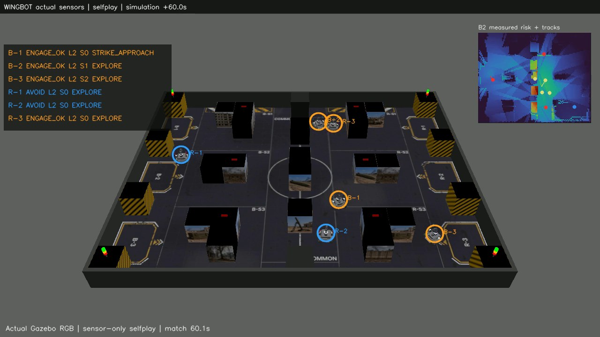

# MAICON 2026 | Gazebo UGV

MAICON 2026 경기장을 Gazebo Fortress에 구성하고, WINGBOT UGV의 자율 임무 코드를 시험하는 저장소입니다. 현재 실행 대상으로 선택한 코드는 **후보 02**입니다.



*후보 02의 6대 자가 대전 영상에서 추출한 실제 Gazebo 화면입니다. [전체 영상](maicon2026_ugv_code/maicon2026/results/candidate02_four_runs/selfplay_seed0/wingbot_selfplay_third_person.mp4)도 볼 수 있습니다.*

## 먼저 볼 곳

| 알고 싶은 것 | 위치 |
| --- | --- |
| 경기장 크기·배치·Gazebo 실행 | [경기장 패키지](maicon2026_ugv_code/maicon2026/ros2/maicon_arena_gz/README.md) |
| 6륜 WINGBOT의 외관·센서·물리 모델 | [로봇 모델](maicon2026_ugv_code/maicon2026/ros2/wingbot_description/README.md) |
| 후보 02 선정 이유와 시험 점수·영상 | [결과 안내](maicon2026_ugv_code/maicon2026/results/README.md) |
| 임무 코드와 설계·검증 문서 | [코드 안내](maicon2026_ugv_code/maicon2026/README.md) · [문서 목차](maicon2026_ugv_code/maicon2026/docs/README.md) |

## 실행 준비

Ubuntu 22.04의 **ROS 2 Humble, Gazebo Fortress, colcon**과 ROS/Gazebo 브리지 및 Python 의존성이 필요합니다. 패키지별 의존성은 [경기장 package.xml](maicon2026_ugv_code/maicon2026/ros2/maicon_arena_gz/package.xml), [로봇 package.xml](maicon2026_ugv_code/maicon2026/ros2/wingbot_description/package.xml)에 기록돼 있습니다. 이 저장소는 Windows 경로에 공백이 있어도 빌드되도록 ROS 패키지 세 개를 공백 없는 Linux 작업공간으로 복사합니다.

비공개 저장소 접근 권한이 있는 Ubuntu 22.04 환경에서 다음을 실행합니다.

```bash
git clone https://github.com/Jo-Young-Woo/MAICON2026.git
cd MAICON2026/maicon2026_ugv_code/maicon2026
ARENA_BUILD_WS="$HOME/maicon_arena_ws" bash scripts/build_arena_gz.sh
export WINGBOT_MODEL_INSTALL="$HOME/maicon_arena_ws/install"
```

빌드는 처음 한 번만 필요합니다. 이미 같은 경로에 빌드한 패키지가 있다면 빌드 스크립트를 다시 실행하기 전에 [빌드 안내](maicon2026_ugv_code/maicon2026/ros2/maicon_arena_gz/docs/runtime.md)를 확인하세요. 이후 새 터미널에서는 `WINGBOT_MODEL_INSTALL`을 다시 지정합니다.

### 경기장과 B-2 한 대 보기

아래 명령은 경기장과 조작 가능한 로봇 한 대를 표시합니다. **자율 경기는 시작하지 않습니다.**

```bash
source /opt/ros/humble/setup.bash
source "$WINGBOT_MODEL_INSTALL/setup.bash"
LIBGL_ALWAYS_SOFTWARE=1 ros2 launch maicon_arena_gz arena.launch.py robot_model:=wingbot profile:=standard ugvs:=1 ego_slot:=B-2 gui:=true render_engine:=ogre2 gui_render_engine:=ogre gui_software_rendering:=false image_transport_profile:=shm64
```

### 선택된 후보 02로 6대 자가 대전

경기장 단독 실행을 종료한 뒤 다음 명령을 실행합니다. 기본값은 시드 0, 최대 300초, **화면 없는 6대 경기**입니다. 3인칭 영상과 보고서는 Git에서 제외되는 `recordings/`의 새 폴더에 저장됩니다.

```bash
bash scripts/run_selected_gazebo.sh
```

실행기는 [선택 설정](maicon2026_ugv_code/maicon2026/config/active_candidate.json)을 읽고, 동결된 후보 02 Python 파일 122개의 해시를 확인합니다. 경기장·로봇 자산 연결은 첫 실행 때 자동 생성됩니다. 경기 없이 검사만 하려면 `python3 scripts/selected_runtime.py`를 실행하세요. 세부 실행 옵션은 [자가 대전 실행기](maicon2026_ugv_code/maicon2026/scripts/run_wingbot_selfplay.py)와 [경기장 실행 안내](maicon2026_ugv_code/maicon2026/ros2/maicon_arena_gz/README.md)에 있습니다.

## 폴더 지도

| 경로 | 역할 |
| --- | --- |
| `maicon2026_ugv_code/maicon2026/ros2/maicon_arena_gz/` | 경기장 사양 YAML, 배치, SDF 월드, 바닥·표적 텍스처, ROS launch |
| `maicon2026_ugv_code/maicon2026/ros2/wingbot_description/` | WINGBOT URDF/xacro, 메시, 센서·구동 설정 |
| `maicon2026_ugv_code/maicon2026/runtime/selected_candidate02/maicon26/` | 해시로 고정한 후보 02 임무 코드 |
| `maicon2026_ugv_code/maicon2026/maicon26/` | 계속 개발하는 임무 코드; 위 동결 코드와 구분 |
| `maicon2026_ugv_code/maicon2026/scripts/` | 실행·생성·분석 도구. 기본 진입점은 `run_selected_gazebo.sh` |
| `maicon2026_ugv_code/maicon2026/results/` | 후보 선정 근거, 완료 경기 점수·보고서·영상 |
| `maicon2026_ugv_code/maicon2026/tests/` | 단위·통합·회귀 시험 |

대회 PDF와 API HTML 등 원본 자료는 저장소 루트에 보존했습니다. 파일 위치를 바꾸면 실행기의 상대 경로와 해시 검증이 깨질 수 있어 코드·자산 디렉터리는 유지했습니다.

## 결과를 읽을 때

후보 02는 **2D 선정 시험**에서 M3 면 누락이 가장 적고, 동률 후보 중 M2+M3 점수가 가장 높아 선택됐습니다. 이는 Gazebo에서 M3 전부 탐지나 최고 점수를 보장한다는 뜻이 아닙니다. [Gazebo 후속 4경기](maicon2026_ugv_code/maicon2026/results/candidate02_four_runs/RESULTS.md)는 실제 모델·센서를 사용했지만 점수는 로컬 채점기의 추정치이며 공식 서버 확정 점수가 아닙니다. 실물 로봇 성능도 아직 검증하지 않았습니다.

경기 자료와 로봇 참고 모델의 재배포 조건은 [자산 출처·라이선스 기록](maicon2026_ugv_code/maicon2026/ros2/wingbot_description/vendor/LICENSE_AUDIT.md)을 확인하세요. 저장소는 현재 **비공개**입니다.
