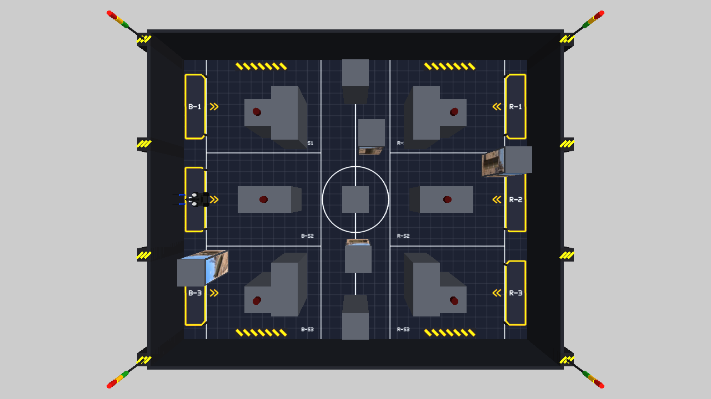
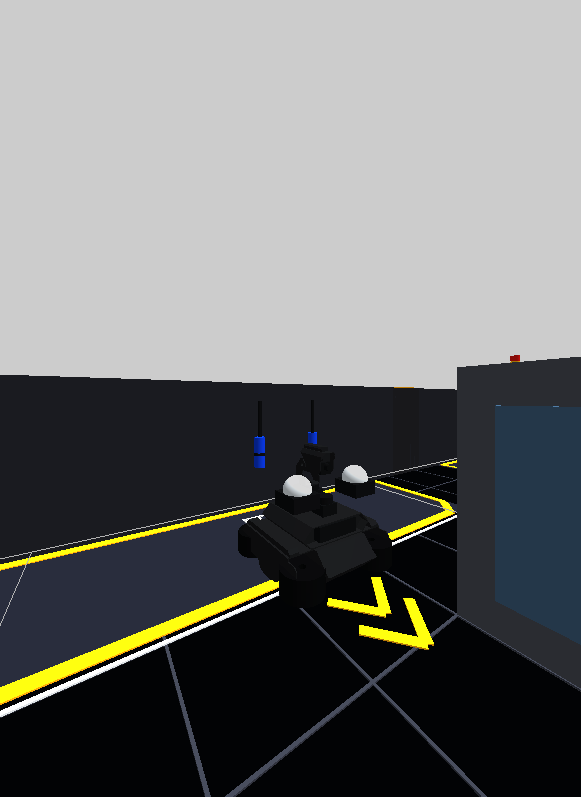

# MAICON 경기장과 UGV Rover Gazebo 시뮬레이션

## 모든 0.4 m 박스 탐색 · UAV 중단 대응 · 1인칭 녹화

UAV는 위에서 보이는 크기와 위치만 전달한다. 사진 부착 여부나 M3 정답은 전달하지 않는다. 기본 배치에서는 기존 정육면체 7개와 추가 사진 박스 4개, **총 11개를 모두 옆면 확인 후보**로 사용한다. M2 표적 또는 빈 면을 지상에서 확인해도 해당 면만 완료하며 나머지 면은 계속 확인한다. 경로 그림도 정답이 아닌 크기를 기준으로 C1–C11을 표시한다. 후보 선정은 모든 면의 접근·관측 성공을 보장하지 않는다.

배치 영상의 촬영 시각은 UAV 로봇 위치 메시지와 별도로 감시한다. 처음부터 영상이 없거나 마지막 영상 후 12초가 지나면 LiDAR 지도에서 아직 안 본 구역과 박스 면을 탐색한다. 오래된 영상으로만 추정한 박스는 경로·목표에서 보류하고, LiDAR로 확인한 구조물과 지상 관측 기록은 유지한다. 복구 시 새로운 두 프레임에서 일치한 박스만 다시 사용하며 탐색 경로를 재평가한다. 보고서의 `B2_coverage.uav_layout`과 `cube_candidates`에 전환 시각·후보·면 상태가 저장된다.

LiDAR 윤곽 일부가 사라진 것만으로 사진 기록을 삭제하지 않는다. 기존 박스 내부를 통과한 자유 공간 증거와 주변 점유 상태를 2초 이상·3회 확인한 뒤 이동을 판단한다. 미완성 박스 가설의 소멸은 독립적인 카메라 기록을 지우지 않으며, 확인된 박스 이동은 위치와 면 방향이 일치하는 기록만 무효화한다. M3 집계는 실제로 센 면만 중복 제외 대상으로 사용하고 직각인 인접 면을 구분한다. 정보가 거의 없는 탐색 경계만 남았을 때도 아직 확인하지 않은 구역으로 넘어간다.

Ubuntu/WSL에서 다음 명령은 경기장 실행, 실제 B2 전방 카메라 녹화, 경기 보고서와 경로 저장, 프로세스 종료까지 수행한다. 이미 있는 영상에는 덮어쓰지 않는다.

```bash
# B2 단독: 처음부터 UAV 없이 탐색
PHYSICAL_ROBOTS=one UAV_SCHEDULE=0:off \
  OUTPUT=ros2/gazebo/recordings/b2_no_uav_fpv.mp4 bash scripts/run_gazebo_fpv_trial.sh
# 물리 UGV 6대: 60초에 UAV 중단, 160초에 재개
PHYSICAL_ROBOTS=six UAV_SCHEDULE=60:off,160:1 \
  OUTPUT=ros2/gazebo/recordings/3v3_uav_outage_fpv.mp4 bash scripts/run_gazebo_fpv_trial.sh
```

두 영상 모두 B2의 고정 전방 카메라(`/B2/fpv/image`, 640×360)를 녹화한다. 3대3은 6대 모두 Gazebo 물리·LiDAR에 존재하고, B2는 현재 Agent/Nav2, 나머지 5대는 재현 가능한 순찰·교전 제어기로 움직인다. 상대 팀의 실제 코드를 재현한 것은 아니다. `FPV=1`일 때만 B2의 추가 카메라를 켜서 기본 시험의 렌더링 부담을 유지한다. 영상은 H.264, 시뮬레이션 시간 기준 10 FPS이며 부족한 프레임은 최대 1초까지 유지하고 더 긴 공백은 누락 화면으로 표시한다. 실제 수신 주파수와 유지·누락 수는 `.recording.json`, 프레임별 원본 시각은 `.frames.jsonl`에 기록된다. 녹화 화면은 실제 렌더링이지만 **UGV 객체 분류 입력은 여전히 합성이므로 영상 인식 정확도 검증은 아니다.**

### 2026-11-09 최종 녹화 결과

두 실행 모두 seed 2, 추가 사진 큐브 4개, 전체 큐브 후보 11개를 사용했다. 아래 파일과 같은 이름의 `.json`에 채점, `.path.png`에 실제 이동 경로, `.recording.json`에 영상 수신 상태를 저장했다.

| 실행 / 영상 | 영상 길이 | M3 정답 일치 / 전체 | M3 정밀도 | M5 |
| --- | --- | --- | --- | --- |
| [B2 단독, UAV 처음부터 중단](recordings/b2_no_uav_fpv_20261109_run3.mp4) | 302.3초 | 9 / 16 | 60% | 시간 내 진입 실패 |
| [물리 UGV 3대3, UAV 60–160초 중단](recordings/3v3_uav_outage_fpv_20261109_run2.mp4) | 252.7초 | 7 / 16 | 88% | 경기 248.9초 진입 |

B2 단독은 제어기에 전달된 UAV 프레임 0개로 300초를 진행했다. 후반에 SLAM 위치 추정이 크게 틀어져 최종 오차 5.282 m를 기록했고, 실제 로봇은 벽 근처에서 정체했다. 3대3은 중단 후 약 70초에 지상 탐색으로 전환했고 약 177초에 UAV 보조 탐색으로 복귀했다. 이후에도 영상 지연 시 지상 탐색과 재확인을 반복했다. 최종 위치 오차는 0.073 m였으며 6대 모두 실제 이동했다. M6 1순위 예측은 불일치했다. 심판기 `World`의 충돌 집계는 각각 0·77회이며, 이는 Gazebo 접촉 센서로 측정한 충돌 횟수가 아니다. 로봇 수와 영상 조건이 다르므로 이 두 실행만으로 UAV 유무의 효과를 단정할 수 없다.

두 MP4의 3,023·2,527 프레임을 모두 디코딩했고 대표 장면을 확인했다. 실제 수신은 약 7.35·6.63 FPS이며 긴 누락 화면은 0개였다. 두 영상 마지막에는 카메라가 가까운 벽을 향해 어둡게 보이는 구간이 있고, 이를 삭제하지 않았다. 관련 단위·통합 테스트 58개와 별도 기존 이동 박스·면 집계 회귀 검증을 통과했다. 앞선 `b2_no_uav_fpv_20261109`, `..._final_20261109`, `3v3_uav_outage_fpv_20261109` 파일은 수정 전 비교 또는 중단 진단 기록이며 최종 결과는 위 두 파일이다.





ROS 2 Humble + Gazebo Fortress용이다. 기본 `LAYOUT=fixed`는 제공된 경기장 이미지의 13개 구조물, 6.12 × 5.00 m 바닥, 0.40 m 외벽, 거점 6개, 격자와 경계선, 현수막을 고정 배치한다. 그 위에 **40 × 40 × 40 cm M3 박스 4개를 시드별로 랜덤 추가**한다. 경기장 그림은 참고용이며 실제 현장은 달라질 수 있다. 이미지 속 맞닿은 기존 구조물은 유지하고, 신규 M3 박스는 다른 구조물·벽과 최소 40 cm 떨어지게 생성한다. `LAYOUT=random`은 경기장 전체를 바꾸는 별도 규격 시험용이다.

바닥 표시 947개를 2448 × 2000 PNG와 텍스처가 포함된 OBJ 평면 한 장으로 합쳤다. Gazebo에서는 `field_markings` 시각 요소 하나만 렌더링한다. `python3 scripts/render_gazebo_field_texture.py`로 다시 생성할 수 있다. 고정 경기장의 구조물·표적 면·거점 종류는 `maicon26/sim/fixed_maicon.py` 한 곳에 정의되어 Gazebo와 판정기가 같은 좌표를 사용한다.

Waveshare의 `ugv_gazebo` UGV Rover 모델을 확인하여 바퀴 간격·직경·차체 질량, 앞뒤 바퀴 4개 구동과 **360점·10 Hz LiDAR** 설정을 반영했다. 이 프로젝트의 Gazebo Fortress에서는 LiDAR 시야를 160°로 유지한다. 현재 WSL의 OGRE 1에서 360° GPU 스캔은 최소 거리만 반환하는 문제가 있었기 때문이다. 기존 640점으로 비교하려면 첫 터미널에 `LIDAR_SAMPLES=640`을 추가한다. Waveshare 원본은 Gazebo Classic용 `gazebo_ros_*` 플러그인을 사용하므로 여기서는 Fortress의 DiffDrive와 `ros_gz_bridge`를 쓴다. 원본의 30 Hz 깊이·팬틸트 카메라는 기본 경기에서 켜지 않으며 영상 인식은 합성 입력이다.

아래 표는 가상 상대가 있는 경기 모드 기준이다. M3 단독 모드는 가상 상대를 생성하지 않으므로 M4·M6 교전 성적을 평가하지 않는다. 로그의 M6 전송 확인은 종료 통신 절차만 뜻한다.

| 미션 | 고정 시험 조건 |
| --- | --- |
| M1 | B2 출발 위치 `(0.35, 2.50)`에서 `통신시설`, `R-S2·COMMON`, `보급기지` 명령 수신·제출 |
| M2 | `통신시설` 표적 면: BLUE 중앙 구조물 `(1.70, 2.50)` 서쪽, RED 중앙 구조물 `(4.42, 2.50)` 동쪽 |
| M3 | 랜덤 정육면체 기본 4개 × 옆면 4개 = 16개 사진의 종류·섹터 보고 |
| M4 | 가상 RED UGV 3대가 RED 거점 앞에 고정되어 탐지·레이저 피격 판정에 참여 |
| M5 | 4분 명령 이후 RED R-1 작전지휘소 거점 `(5.92, 4.16)` 진입 |
| M6 | 종료 명령 후 가상 RED 3대의 실제 교전 기록에 대한 위협 순위 제출 |

M1·M6는 물리적 표지물이 아니라 서버 메시지와 제출 시험이다. 기본 경기는 **Gazebo에 B2 한 대만** 띄운다. 가상 상대는 Gazebo 물리·LiDAR에 나타나지 않고, 임무 판정용 카메라/UAV 검출에만 반영된다.
고정 배치에서 M5 전 대기점은 `(3.60, 3.00)`이다. 일반 경기장용 기본 좌표 `(4.12, 2.50)`는 이 배치의 R측 중앙 장애물 안에 들어가므로, 경기 시험에서만 대기점을 옮긴다.
거점 경계 앞에서 위치 추정 오차로 멈추면 고정 Gazebo 시험에 한해 최대 3초간 저속 진입을 시도한다. 실제 경기 로봇 설정에서는 이 동작의 기본값이 꺼져 있다.

### 랜덤 M3 박스와 탐색

1차 사전교육 PDF p13은 400×400×400 mm 정육면체의 네 옆면에 각각 객체 그림 하나를 붙이며, 6종(탄약 상자·드럼통·박격포·트럭·전차·미사일)을 제시한다. 배치와 수량은 구역별로 랜덤이고 실제 경기 그림은 예시와 다를 수 있다. p24의 최소 40 cm 간격을 새 박스에 적용한다. 기본 **4개는 실험 설정이며 공식 수량이 아니다**. 배치 생성기는 기존 구조물과의 간격, 6개 거점과 대기점으로 이어지는 36 cm 폭의 보수적 통로, 모든 옆면을 볼 수 있는 접근 위치를 검사한다. 생성할 수 없는 수량은 오류로 알려 주며 박스를 조용히 생략하지 않는다.

옆면에는 PDF 예시 사진을 추출한 `assets/m3_photos/`의 PNG/OBJ/MTL을 사용한다. `source.json`에 출처를 보관하고 `scripts/extract_m3_textures.py`로 재추출할 수 있다. 기존 직사각형의 M3 색상 패널은 제거했다. 바닥은 여전히 한 장의 텍스처이고 로봇은 B2 한 대이므로, 사진 부착을 위해 물리 객체나 센서를 늘리지 않는다.

새 배치를 만들 때는 두 터미널에 **같은 시드와 수량**을 지정한다. 같은 값은 같은 배치·그림을 재현한다. 다른 배치는 시드를 변경한다.

한 번에 실행하려면 `SEED=2 M3_COUNT=4 bash scripts/run_gazebo_m3_trial.sh`를 사용한다. 경기장 생성·단일 로봇 자동 주행·결과/경로 저장·종료를 묶어서 시드가 어긋나지 않게 한다. 기본은 **가상 상대도 없는 UGV 한 대 M3 시험**이다. 가상 RED 3대가 있는 경기 조건은 `OPPONENTS=virtual`로 선택한다. 두 모드의 성적은 직접 비교하지 않는다. 기본 ROS 도메인은 195이고, GUI 없이 검사할 때는 `HEADLESS=1`을 추가한다. UAV 힌트 비교 시험은 `UAV_LAYOUT=off`를 지정한다.

```bash
# 터미널 1: 경기장 + 로봇 + Nav2
SEED=2 M3_COUNT=4 LAYOUT=fixed ROBOT=B2 CONTROL=match bash scripts/gazebo_nav_demo.sh
# 터미널 2: 현재 Agent로 자동 경기
source /opt/ros/humble/setup.bash
python3 scripts/run_gazebo_match.py --seed 2 --m3-count 4 --uav-layout image \
  --opponents none \
  --report ros2/gazebo/recordings/m3_random4_image.json
```

탐색은 각 면의 후보를 먼저 고르게 만들고, 구역별 경로 검사를 보장하며, 오랫동안 관측하지 않은 구역에 가중치를 준다. 6초 동안 선택한 목표를 유지해 잦은 취소를 줄인다. 일반 후보가 없으면 미탐색 구역을 순회하고, M5 준비·명령 시간은 계속 우선한다. 보고서의 `B2_trajectory`, `B2_coverage`, `B2_exploration`에 실제 경로, 면 장부, 후보 탈락 이유를 남긴다.

UAV와 LiDAR의 두 개 이상 떨어진 구조물 관측이 일치할 때만 두 좌표계의 평행 이동을 추정한다. 내비게이션에는 보정한 위치를 쓰고 M3 섹터 보고에는 원래 UAV 경기장 좌표를 보존한다. 애매한 대응은 보정하지 않는다. UAV 장애물 정보는 임시 경로 비용에만 합치며, 계산한 우회 경로의 중간 경유점을 Nav2에 전달한다. Nav2가 목표를 바꾸며 복구를 반복해도 8초 동안 8cm 이상 이동하지 못하면 기존 충돌 검사와 LiDAR 제한을 유지하는 내장 경로 추종으로 전환한다.

지연된 UAV에 찍힌 자기 로봇은 촬영 시점의 자세와 연속적인 이동으로 식별하며, 가까운 다른 아군은 제거하지 않는다. LiDAR 이동체 후보는 이전에 자유 공간으로 관측했던 곳에서만 만들고, 최근 UAV와 3회 이상 완전한 LiDAR 관측이 함께 확인한 고정 구조물의 내부 오인만 제거한다. 카메라/UAV로 확인한 로봇, 구조물 경계와 바깥의 이동체는 유지한다.

실행 중에는 같은 이름의 `.checkpoint.json`에 5초마다 진행 상태를 저장한다. 센서 입력이 오래 끊기면 로봇을 정지하고 `completed: false`와 오류를 결과에 남긴다. 경로 그림은 실제 Gazebo 위치에서 생성하며, 박스 정답 좌표는 결과 설명용으로만 기록한다.

2026-11-09 최종 단독 시험(`seed=2, m3_count=4, opponents=none, uav_layout=image`)은 248.35초에 거점 진입·종료 통신까지 완료했다. 실제 이동은 31.7m이며 상단과 하단을 모두 주행했다. 최종 M3 제출은 12개, 정답 수량 16개 중 일치 11개(재현율 69%, 정밀도 92%)였다. 완전 탐색 성공은 아니다. 심판 시뮬레이터의 충돌 카운트는 12, 최종 위치 추정 오차는 0.201m로 추가 튜닝이 필요하다. 충돌 카운트는 `World`의 주행 예측 판정이며 Gazebo 접촉 센서의 독립 계측은 아니다.

결과는 `recordings/m3_random4_solo_final.json`, 로그는 같은 이름의 `.log`, 실제 경로는 `.path.png`다. UAV 이미지에서 매번 17개 상면을 검출했고 이 실행에서 93개 영상 기반 형상 프레임을 전달했다. 자기 UAV 관측 234개를 추적 대상에서 제외했다. 고정 구조물 오인 제거는 재현 단위 검사에서 통과했으며, 이번 실행의 실제 억제 카운트는 0이었다. 가상 상대를 둔 별도 실행(`m3_random4_uav_verified.json`)은 M3 9/16 일치·정밀도 82%였다. 서로 조건이 달라 성능 향상의 정량 비교로 사용하지 않는다.

검사: 핵심 84개 + 고정 구조물 오인 제거 6개 통과, SDF 형식 검사 통과. 일반 랜덤 시나리오는 기존 UAV 입력 계약을 유지하고, 고정 MAICON 시험에서만 합성 형상 힌트를 기본 활성화한다. 변경 중 확인된 일반 회피 시나리오 회귀는 이 범위 제한으로 해결하고 해당 검사를 재통과했다.

### 고정형 UAV 경기 연습

규정 PDF의 고정 시점 UAV를 경기장 중앙 상공 2.5 m의 **정적 Gazebo 카메라**로 표현했다. 1280×720 영상이 `/uav/image`로 1 FPS 발행되며, 경기장 전체가 보이도록 카메라 방향과 시야각을 정했다. 영상 확인은 `python3 scripts/capture_uav_image.py --output ros2/gazebo/assets/fixed_uav_first_frame.png`로 한다.

M1~M6 Agent가 받는 `UavFrame.detections`의 **UGV 위치는 심판 World의 위치에 0.4초 지연과 0.04 m 잡음을 적용한 합성 탐지**다. B2 이외의 가상 상대 3대는 카메라 화면에 나타나지 않는다. 반면 `UavFrame.boxes`는 기본 `--uav-layout image`에서 **실제 `/uav/image`의 박스 상면 픽셀**로 계산한다. 고정 카메라 자세·시야각과 40 cm 높이 평면으로 좌표를 보정한다. 이 검출기는 Gazebo의 회색 상면·고정 조명을 가정하며 실제 UAV 영상에 그대로 적용하지 않는다.

상공 영상은 위치·크기 후보만 제공한다. 객체 이름·각 면의 정답은 전달하지 않는다. 두 장에서 일치한 후보를 탐색 장부에 추가하고, UGV가 도착하여 거리·입사각·시야·가림 조건을 충족한 옆면 관측만 M3 집계에 사용한다. UAV 힌트는 SLAM 점유격자나 '관측 완료' 기록을 덮어쓰지 않는다. 공급이 끊기면 신규 힌트가 멈추고 기존 장부와 LiDAR로 계속 탐색한다. `--uav-layout off`는 동일 배치에서 UAV 구조물 힌트를 끄는 비교 시험이다. 원래의 순수 Python 시뮬레이터는 `synthetic_overhead_footprints`로 명시된 형상 힌트를 사용한다.

경기 실행 시 합성 UAV 프레임의 시각을 Gazebo `/clock` 기준으로 변환한다. 로봇 번호의 초기 거점 식별은 시계의 절대값이 아닌 첫 UAV 프레임부터 지난 3초를 기준으로 한다. 가상 상대는 RED 거점 중심에서 0.75 m 이내에 배치해 초기 식별 조건을 만족시킨다.

기본 제공 간격은 1초다. 상대 팀의 지정표적 유효 타격이 1회/2회/3회 발생하면 우리 팀 프레임 제공 간격이 2초/5초/중단으로 바뀐다. 운영자가 임의로 제공 정책을 변경하는 연습도 가능하다. 아래 예시는 경기 시각 90초, 160초, 220초에 각각 2초, 5초, 중단으로 설정한다. 이 시간표는 **시험용 운영 통제 가정**이며 실제 경기 타격 사건을 뜻하지 않는다. Gazebo 카메라는 계속 1 FPS로 촬영하고 Python 서버가 팀에 전달하는 프레임을 제한한다.

```bash
python3 scripts/run_gazebo_match.py --layout fixed --physical-robots one \
  --seed 2 --duration 300 --base-at 240 --smog-at 120 \
  --uav-schedule 90:2,160:5,220:off \
  --report ros2/gazebo/recordings/maicon_fixed_uav_300s.json
```

2026-11-08 기존 14면 배치 실행(이하 수치는 랜덤 M3 추가 전): B2 물리 1대와 가상 RED 3대로 시작해 246.9초에 R-1 진입 및 경기 종료, M6 제출까지 마쳤다. M1·M2·M5는 성공했다. M3는 14개 정답 중 재현율 0.86, 정밀도 0.75였다. M4 타격은 0회이고 M6의 1순위는 정답과 달랐다. UAV 프레임은 131장 전달됐고 Agent 상태는 `normal → slow2 → slow5 → off`로 바뀌었다. 위치 추정 최종 오차는 0.108 m, 실제 경과 시간은 251.22초였다. 상세 채점·이벤트는 `recordings/maicon_fixed_uav_300s.json`, 텍스트 로그는 `recordings/maicon_fixed_uav_300s.log`, 실행 중 실제 카메라 사진은 `recordings/maicon_fixed_uav_match.png`에 있다. 가상 RED 로봇은 물리·영상 객체가 아니므로 M4·M6 성적은 실제 상대 로봇과의 교전 성능으로 해석할 수 없다.

같은 설정을 Gazebo GUI에서 다시 실행한 영상은 `recordings/maicon_fixed_uav_20261108_arena.mp4`에 저장했다(경기장 확대 화면, H.264, 1280×720, 10 FPS, 256.2초). 편집 전 창 전체 녹화는 `maicon_fixed_uav_20261108_raw.mp4`, 해당 실행의 채점은 `maicon_fixed_uav_20261108_raw.json`이다. 이번 녹화 실행은 경기 시각 250.0초에 R-1 진입으로 종료됐고, M3 재현율 0.64·정밀도 0.69, M4 타격 0회, M6 1순위 불일치였다. `maicon_fixed_uav_20261108_arena_video_check.json`에 전체 프레임 디코딩 검사 결과를 남겼다.

로봇 외형은 사용자가 제공한 `ugv_ws-ros2-humble-develop.zip`에서 **UGV Rover**의 STL 11개를 가져왔다. 본체, 4개 바퀴, 깊이 카메라, LiDAR, 팬틸트 부품의 위치는 `ugv_rover.urdf`를 따른다. 경기 사진의 피격 수신부 2개와 팀 색상 안테나는 별도 근사 형상이다. 물리 충돌은 단순 박스와 원통으로 계산한다. 원본 ZIP의 Gazebo Classic ROS 플러그인 대신 Fortress DiffDrive 플러그인을 사용한다.

Waveshare의 [Gazebo 디버깅 절차](https://www.waveshare.com/wiki/UGV_Rover_Jetson_Orin_ROS2_11._Gazebo_Simulation_Debugging)는 로봇 실행 → 키보드 주행 → LiDAR 지도 작성 → 목표점 항법 순서다. 아래의 직접 조종, 토픽 검사, M1~M6 시험도 같은 순서로 점검할 수 있게 구성했다. 원본 위키의 집 내부 예제 대신 MAICON 경기장 SDF를 사용한다.

## 준비

```bash
sudo apt update
sudo apt install ros-humble-ros-gz ros-humble-navigation2 ros-humble-nav2-bringup \
  ros-humble-cartographer-ros ros-humble-slam-toolbox
cd /path/to/maicon2026_ugv_code/maicon2026
```

다른 컴퓨터로 프로젝트를 옮겨 STL이 없는 경우 원본 ZIP에서 다시 추출한다.

```bash
python3 scripts/import_ugv_rover_meshes.py /path/to/ugv_ws-ros2-humble-develop.zip
```

## 경기장 보기와 항법

```bash
LAYOUT=fixed ROBOT=B2 CONTROL=nav2 bash scripts/gazebo_nav_demo.sh
```

별도 터미널에서 `source /opt/ros/humble/setup.bash` 후 `/scan`, `/odom`, `/clock`, `/navigate_to_pose`를 확인할 수 있다. 헤드리스는 `HEADLESS=1`을 붙인다. 기본 GUI는 WSLg GPU OpenGL(`GUI_LIBGL_ALWAYS_SOFTWARE=0`)을 사용한다. 이 WSL/OGRE 1 조합에서 센서 서버까지 GPU로 실행하면 LiDAR 거리값이 모두 무효가 되어, 서버는 `SIM_LIBGL_ALWAYS_SOFTWARE=1`로 분리했다. `python3 scripts/check_gazebo_topics.py`에서 `valid_beams`를 확인한다. GUI GPU가 지원되지 않는 컴퓨터에서만 `GUI_LIBGL_ALWAYS_SOFTWARE=1`을 지정한다.

센서 연결 상태와 실제 LiDAR 빔 수·수신 주파수는 `python3 scripts/check_gazebo_topics.py`로 확인한다. JSON의 `ok`가 `true`이고 `valid_beams`가 0보다 커야 한다. 640점 설정으로 띄웠으면 검사에도 `--lidar-samples 640`을 지정한다.

### B2 직접 조종

한 대만 띄운 상태에서 키보드로 움직이려면 첫 터미널에서 다음을 실행한다.

```bash
LAYOUT=fixed ROBOT=B2 CONTROL=match bash scripts/gazebo_nav_demo.sh
```

둘째 터미널에서 다음을 실행하고, 키보드 조종 프로그램의 안내에 따라 속도를 조절한다.

```bash
source /opt/ros/humble/setup.bash
ros2 run teleop_twist_keyboard teleop_twist_keyboard --ros-args -r cmd_vel:=/cmd_vel
```

직접 조종하는 동안 `run_gazebo_match.py` 또는 `run_gazebo_agent.py`를 함께 실행하지 않는다. 두 프로그램도 `/cmd_vel`로 명령을 보내기 때문이다. 수동 조종은 경기장과 LiDAR 주행 점검용이고, M1~M6 자동 경기 시험은 아래 명령을 사용한다.

Waveshare 안내와 같이 수동 주행으로 경기장을 스캔한 뒤 2D 지도를 저장할 수 있다.

```bash
ros2 topic echo /map --once --field info
ros2 run nav2_map_server map_saver_cli -f /tmp/maicon_fixed_map
```

저장 결과는 `/tmp/maicon_fixed_map.pgm`과 `/tmp/maicon_fixed_map.yaml`이다.

## MAICON Agent 단일 UGV 시험

첫 터미널:

```bash
LAYOUT=fixed ROBOT=B2 CONTROL=agent HEADLESS=1 bash scripts/gazebo_nav_demo.sh
```

둘째 터미널:

```bash
source /opt/ros/humble/setup.bash
python3 scripts/run_gazebo_agent.py --duration 60 --report ros2/gazebo/agent_trial.json
```

Agent가 Gazebo LiDAR와 오도메트리, Nav2를 사용해 주행한다. 카메라 인식과 임무 서버는 시험용 합성 입력이다.

## B2 한 대로 M1~M6 경기 시험

첫 터미널:

```bash
LAYOUT=fixed ROBOT=B2 CONTROL=match HEADLESS=1 bash scripts/gazebo_nav_demo.sh
```

둘째 터미널:

```bash
source /opt/ros/humble/setup.bash
python3 scripts/run_gazebo_match.py --layout fixed --physical-robots one \
  --seed 2 --duration 300 --base-at 240 \
  --smog-at 120 --report ros2/gazebo/match_trial.json
```

B2는 현재 MAICON Agent와 Nav2로 움직인다. `World`/`SimServer`가 M1~M6 시간표와 판정, 레이저 지속 조준·쿨다운·피격, 스모그 이벤트, 거점 진입을 계산한다. Gazebo는 B2의 실제 위치·바퀴 접지·LiDAR를 공급한다. 결과 JSON에는 임무별 점수, 위치 추정 오차, 이동 거리, Nav2 재계획·복구 횟수가 기록된다. 6대 물리 시험이 필요한 경우에만 `ROBOT=all`과 `--physical-robots six`를 함께 사용한다.

**검증 범위:** UAV 구조물 위치는 실제 Gazebo 영상에서 검출한다. UGV의 옆면 객체 분류와 UAV의 UGV 위치 탐지는 여전히 합성 입력이며, M3 사진은 외형 표현용이다. 이 실행으로 YOLO 사진 인식 성능을 검증했다고 해석하면 안 된다. M2는 색상 표적과 판정 이벤트, 스모그는 판정 이벤트로 표현하며 발광 하드웨어·입자 시각 효과는 없다. 실제 MIL 서버·YOLO 가중치·상대 팀 코드와의 통합은 이 시험에 포함되지 않는다. 기존 M2 채점은 표적 클래스만 비교하므로 동일 종류의 아군 시설 타격까지 성공으로 표시할 수 있다. WSL Fortress/OGRE 1에서 LiDAR의 넓은 시야가 최소거리만 반환해 전방 160° 스캔을 사용한다.

단독 SDF 생성은 `python3 scripts/generate_gazebo_world.py --layout fixed --robot B2 --output /tmp/arena.sdf`로 한다. 직접 열 때는 `IGN_GAZEBO_RESOURCE_PATH`에 `ros2/gazebo`의 절대 경로를 넣어 현수막과 블록 텍스처를 찾는다.
